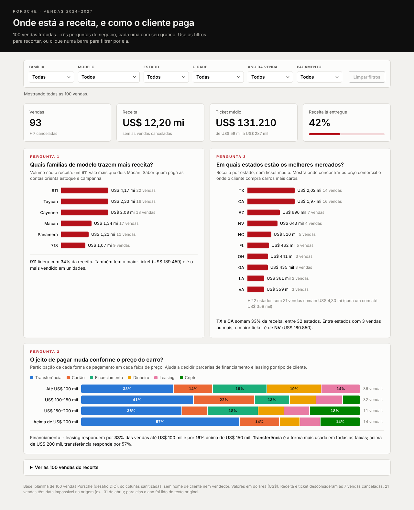
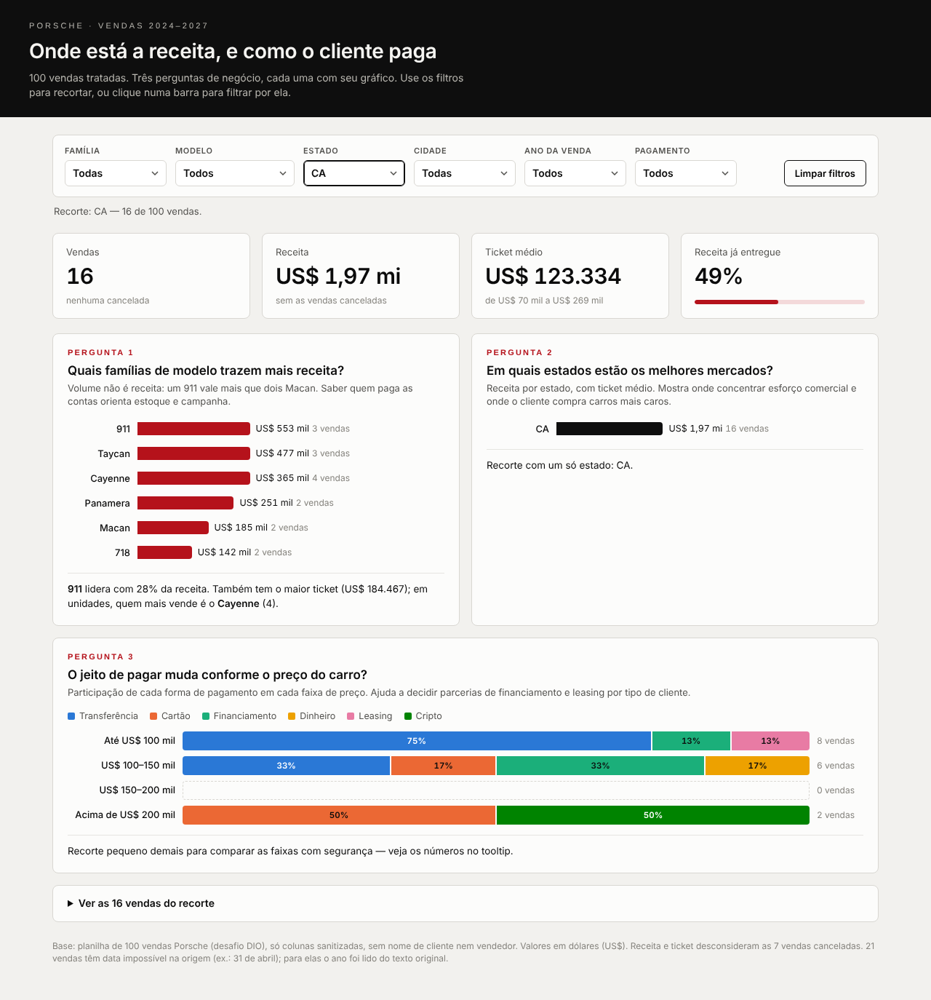

# Dashboard de vendas Porsche

Dashboard interativa em HTML (arquivo único) feita a partir de uma planilha de 100 vendas Porsche, como parte do desafio da DIO *Criando Agentes de Tratamento de Dados*.

**Dashboard publicada:** https://daniandrea-oliv.github.io/dashboard-vendas-porsche/



---

## As perguntas de negócio, e por quê

| # | Pergunta | Gráfico | Por que ela importa |
|---|----------|---------|---------------------|
| 1 | **Quais famílias de modelo trazem mais receita?** | Barras horizontais de receita por família (911, Taycan, Cayenne, Macan, Panamera, 718), com o nº de vendas ao lado | Volume e receita não são a mesma coisa: um 911 custa mais que dois Macan. Saber quem paga as contas orienta estoque e campanha. |
| 2 | **Em quais estados estão os melhores mercados?** | Barras horizontais dos 10 estados com mais receita; o ticket médio aparece ao passar o mouse | Mostra onde concentrar esforço comercial e onde o cliente compra carros mais caros. Usei **estado** em vez de cidade porque são 79 cidades para 100 vendas (quase uma venda por cidade), e assim nenhum padrão aparece. |
| 3 | **O jeito de pagar muda conforme o preço do carro?** | Barras 100% empilhadas: forma de pagamento dentro de cada faixa de preço | Ajuda a decidir parcerias de financiamento e leasing para cada tipo de cliente. |

Cada pergunta tem uma frase de resposta embaixo do gráfico, **calculada sobre o recorte atual**, que muda junto com os filtros.

**O que a base responde (sem filtros):**
- O **911** lidera com 34% da receita. Também tem o maior ticket médio (≈ US$ 189 mil) e é o mais vendido.
- **TX e CA** somam um terço da receita, entre 32 estados.
- **Financiamento + leasing** respondem por 33% das vendas até US$ 100 mil, mas só por 16% acima de US$ 150 mil. Quem compra o carro mais caro paga mais por **transferência** (57% acima de US$ 200 mil).

### Indicadores de topo
Vendas · Receita · Ticket médio · % da receita já entregue.
As **7 vendas canceladas** ficam fora da receita e do ticket, porque contar como receita um carro que não foi vendido inflaria o número. Na tabela, elas aparecem riscadas.

### Filtros
Família, modelo, estado, cidade, ano da venda e forma de pagamento. Os filtros são **encadeados**: escolhendo a família 911, o filtro de modelo só oferece modelos 911. Também dá para **clicar numa barra** (família ou estado) para filtrar por ela, e clicar de novo para desfazer.

**Exemplo de filtro aplicado (Estado = CA):**



---

## Tratamento da base antes de ir para a IA

O script [`scripts/preparar_base.py`](scripts/preparar_base.py) faz tudo e pode ser rodado de novo com uma base nova:

```bash
pip install openpyxl
python scripts/preparar_base.py caminho/da/planilha.xlsx
```

1. **Só as colunas sanitizadas.** O dado cru (`sale_price` = "$121k", "68.900 dollars"…) foi descartado e ficaram as versões tratadas no curso.
2. **Preço, ano e quilometragem convertidos em número** (o ano vinha como texto, e às vezes por extenso: "twenty twenty four").
3. **Dado pessoal removido.** `customer_name` e `salesperson` não entram, porque a base vai embutida no HTML e qualquer pessoa que abrir a página consegue ler.
4. **Segunda regra para as datas INVALID.** 24 datas tinham ficado `INVALID`:
   - 3 estavam no formato AAAA/DD/MM (ex.: `2024/15/07`) e foram **recuperadas** (→ 15/07/2024);
   - 21 são datas impossíveis (31 de abril, 30 de fevereiro, dia 40…) e continuam sem data. Mesmo assim, o **ano** está legível no texto original, então todas as 100 vendas entram no filtro de ano. A coluna `status_data` diz qual caso é cada uma (`original`, `recuperada`, `invalida`).
5. **Colunas derivadas:** `familia` (primeira palavra do modelo), `grupo_pagamento` (9 métodos agrupados em 6: Transferência = wire + bank + ACH; Cartão = crédito + débito; Financiamento; Leasing; Dinheiro; Cripto).

Saídas: [`data/vendas_porsche_tratada.csv`](data/vendas_porsche_tratada.csv) (a base tratada) e os mesmos dados embutidos no `index.html`.

**Observação sobre a base:** 20 vendas têm data em 2027, ou seja, depois de hoje. É uma base de exercício, então mantive esses registros e deixei o ponto anotado. Numa base real, eu voltaria à origem para checar.

---

## Ferramenta usada e o prompt

Usei um **agente (Claude) com uma skill de visualização de dados**, que trata a base, escreve o HTML e confere o resultado. <!-- Se você também fizer o caminho do ChatGPT com Canvas, conte aqui a comparação. -->

### Prompt
> Tenho uma planilha com 100 vendas da Porsche (anexa). Use só as colunas sanitizadas, converta preço e ano em número e retire nome do cliente e do vendedor, porque a base vai embutida no HTML.
>
> Crie uma dashboard em **HTML, arquivo único**, sem biblioteca externa de gráficos, que responda a três perguntas:
> 1. Quais famílias de modelo trazem mais receita?
> 2. Em quais estados estão os melhores mercados (receita e ticket médio)?
> 3. A forma de pagamento muda conforme a faixa de preço do carro?
>
> No topo: total de vendas, receita, ticket médio e % da receita já entregue. Filtros de família, modelo, estado, cidade, ano da venda e forma de pagamento. Embaixo de cada gráfico, uma frase com a resposta, recalculada com os filtros.
>
> Visual inspirado na Porsche: cabeçalho preto, fundo off-white, vermelho como cor de destaque, tipografia sem serifa e limpa.

### Decisões tomadas antes de gerar
- **Estado em vez de cidade na pergunta 2.** Com 79 cidades para 100 vendas, o gráfico por cidade seria uma lista de barras quase iguais. A cidade ficou como filtro.
- **Vendas canceladas fora da receita e do ticket.**
- **Segunda regra de data**, depois de olhar quais registros tinham ficado INVALID.

### O que mudou da 1ª versão até a final (refinando em linguagem natural)
- **Barra "Outros" retirada.** Os 22 estados fora do top 10, somados, davam uma barra maior que a do 1º colocado e distorciam a leitura. Eles viraram uma nota embaixo do gráfico.
- **Frases de resposta calculadas.** Uma frase tinha ficado fixa ("transferência é a mais usada em todas as faixas") e não valeria para alguns recortes. Agora todas são calculadas a partir do recorte.
- **Frase da pergunta 1 reescrita.** Num recorte, ela dizia "o maior ticket é do 911" logo depois de "911 lidera", o que soava estranho.
- **Moeda padronizada** no formato brasileiro (US$ 131.210). Antes, os KPIs misturavam "US$ 12,20 mi" com "$131,210".
- **Rótulos das faixas de preço alargados**, porque "Acima de US$ 200 mil" quebrava em duas linhas.

---

## Estrutura do repositório

```
index.html                       dashboard (dados embutidos)
data/vendas_porsche_tratada.csv  base tratada
scripts/preparar_base.py         tratamento + atualização do index.html
docs/print_geral.png             print da dashboard
docs/print_filtro_ca.png         print com filtro aplicado
```

A planilha original não está no repositório porque tem nome de cliente.
